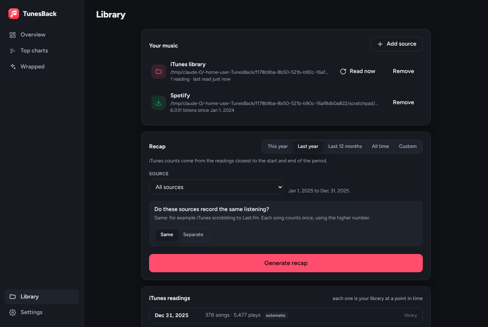
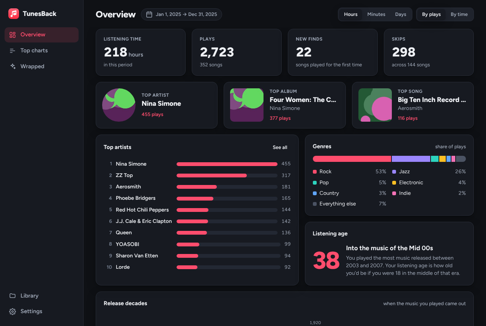
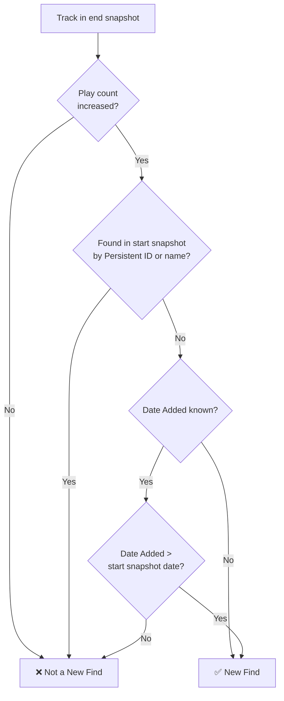

<div align="center">
  
  
# **TunesBack**

**The replay statistics for the rest of us.**

*Year-in-review for iTunes and iPod users.*

  [](https://www.gnu.org/licenses/gpl-3.0)
  


 📖 [Quick Start](https://github.com/mooseses/TunesBack#quick-start)

  <br/>

</div>

<div align="center">
  
  
</div>
<div align="center">
  <em>TunesBack App - Library and Overview</em>
</div>

## Why TunesBack?

Spotify has Wrapped. Apple Music has Replay. But what about iTunes and iPod users?

TunesBack brings year-end analytics to your local music library. Track your listening habits, see your top artists, albums and songs, and discover how your taste evolves over time.

Works with iTunes and Apple Music libraries on **Windows, macOS, and Linux**.

## Features

- **Compare periods** or analyze a single snapshot. Snapshot dates are read from the export itself, so file names don't matter
- **Overview dashboard**: listening time, plays, new finds, skips, top artist/album/song, top artists chart, genre share, release decades and Listening Age
- **Top charts** for Songs, Albums, Artists, Genres, Release Years, New Finds and Skipped tracks, with filtering and 10–100 rows
- **Album art** displayed alongside track details, loaded as you scroll
- **Network share support**: seamlessly works with UNC paths (Windows) and GVFS/CIFS mounts (Linux)
- **Wrapped cards:** shareable Spotify-style visual summaries
- **Listening Age:** calculates the "era" of music you gravitate toward
- **Flexible display:** switch between hours, minutes and days; rank by plays or listening time
- **Dark and light mode**, or follow the system
- **Native-feeling window:** TunesBack's own title bar by default (or your system's, in Settings), a File/View/Help menu bar with keyboard shortcuts, the macOS menu bar on Macs and the global menu on KDE Plasma
- **Fully offline:** all processing happens on your machine

## Wrapped Cards

Generate shareable images summarizing your listening habits.

<p align="center">
  
  
  
  
</p>

<p align="center">
  
  
  
</p>

**Available cards:**
- **Top Songs & Albums**: ranked lists with album artwork
- **Top Genres**: typographic genre tiles
- **Top Song**: hero card with large cover art
- **Minutes Listened**: total listening time
- **Listening Age**: your calculated musical age
- **Summary**: overview combining top artist, stats, and genres

The order of items follows the "By plays / By time" setting at the top right. Re-generate after changing the ranking.

> More card types to come!

## Listening Age

TunesBack computes a single-number summary called the "Listening Age" to describe the era that most strongly characterizes your listening habits. The metric is inspired by the psychological "reminiscence bump", which is the tendency for music encountered during one's formative years to retain stronger emotional significance.

The following chart explains its methodology:

<div align="center">
  
<br/>
  <em>Listening Age Algorithm</em>
</div>


#### How the metric is calculated (algorithmic summary):

- Aggregate play counts by each track's release year.
- Slide a 5-year window across the years in your data and compute the total plays for each window.
- Select the 5-year window with the highest total plays (the "peak era").
- Take the center year of that window and assume the listener was 18 at that midpoint.
- Calculate Listening Age as: current year − (midpoint year − 18).

Formula:

```
Listening Age = Current Year - (Peak Era Midpoint - 18)
```

Example:

- Peak window: 2010–2014 → midpoint 2012
- Assumed birth year: 2012 − 18 = 1994
- Listening Age (in 2025): 2025 − 1994 = 31

Notes and interpretation:

- A Listening Age lower than your chronological age indicates a preference for more recent releases.
- A Listening Age higher than your chronological age indicates a preference for older material.
- The method uses a fixed 5-year window and a formative age constant of 18; these parameters reflect a balance between sensitivity and robustness in typical music libraries.

Implementation details: the algorithm (see `tunesback/stats/listening_age.py`) filters out invalid years, sums the period's plays per release year, evaluates every 5-year window, selects the highest-sum window, and computes the final age as shown above. "Current year" is the year of the (end) snapshot, so older snapshots get the age you had back then.

## New Music Finding

When comparing two library snapshots, a track counts as a **New Find** when it was added to your library during the period and played. Tracks that were already in your library but simply hadn't been played don't count.

### Classification Criteria

A track in the end snapshot is a **New Find** only if **all** of the following are true:

1. **Played in the period**: its play count went up between the two snapshots.
2. **Not in the start snapshot**: no track with the same **Persistent ID** exists there. If IDs changed (for example after rebuilding the library), TunesBack also matches on title, artist and album, as long as that match is unambiguous.
3. **Added after the start snapshot**: if the track has a `Date Added`, it must be later than the start snapshot's date. This catches existing tracks that couldn't be matched.

New Finds are only shown when comparing two snapshots.

### Why Persistent ID?

iTunes assigns each track a unique **Persistent ID** that remains constant even if the file is renamed, moved, or re-tagged. Matching by ID first means edited metadata doesn't turn an old favourite into a "new" track.

### Decision Flow



Implementation details: see `period_activity()` in `tunesback/stats/period.py`.

## Album Art & Network Share Support

TunesBack extracts album artwork directly from your audio files using **embedded metadata tags** and features **intelligent path resolution for network shares**. This ensures artwork displays even when files are stored on remote servers or have been moved.

### How it works

1. **Direct extraction**: Uses [Mutagen](https://mutagen.readthedocs.io/) to read embedded artwork from audio file tags (ID3, MP4, FLAC, etc.). If a file has none, a `cover.jpg`, `folder.jpg` or `front.jpg` next to it is used instead
2. **Smart path resolution for network shares**: Automatically handles:
   - **Windows UNC paths**: Converts `file://server/share/...` to `\\server\share\...`
   - **Linux GNOME/GVFS**: Auto-detects mounts at `/run/user/<uid>/gvfs/smb-share:...`
   - **Linux KDE/kio-fuse**: Auto-detects Dolphin mounts at `/run/user/<uid>/kio-fuse-*/smb/...`
   - **macOS network volumes**: Resolves `/Volumes/...` paths
   - **Moved files**: Works as long as the new path is accessible
3. **No configuration needed**: Network paths are resolved automatically across all platforms


### Troubleshooting missing artwork

If album art doesn't appear:

1. Turn on **Settings → Detailed logging**
2. Check the log file for path resolution errors:
   - **macOS:** `~/Library/Logs/TunesBack/tunesback.log`
   - **Windows:** `%LOCALAPPDATA%\TunesBack\Logs\tunesback.log`
   - **Linux:** `~/.cache/TunesBack/logs/tunesback.log`
3. Verify your audio files have embedded artwork:
   ```bash
   # macOS/Linux
   ffprobe -v error -show_entries format_tags=title -of default=noprint_wrappers=1 "song.mp3"
   
   # Or use any audio tagger to check
   ```
4. For network shares, ensure they're mounted before starting TunesBack

### Network share setup

**Windows:**
- Map network drive or use UNC paths directly
- XML paths like `file://server/share/Music/...` and `file://localhost//server/share/...` are automatically converted

**Linux:**
- **KDE/Dolphin**: Simply browse to the network share in Dolphin before launching TunesBack
- **GNOME/Nautilus**: Connect via Files → Other Locations → Connect to Server
- **Manual mount**:
  ```bash
  sudo mount -t cifs //server/share /mnt/music -o username=user
  ```


## Quick Start

### 1. Run TunesBack

**Download from** [Releases](https://github.com/mooseses/TunesBack/releases)

| Platform | Format |
|----------|--------|
| Windows | Installer (`.exe`) |
| macOS | Disk image (`.dmg`) |

> **macOS:** You may need to go to **System Settings → Privacy & Security** and click "Open Anyway" the first time.

> **Linux:** there is no packaged build yet. Run from source (below).

### Run from source (any platform)

Requires Python 3.10+.

```bash
git clone https://github.com/mooseses/TunesBack.git
cd TunesBack
python3 -m venv venv
source venv/bin/activate        # Windows: venv\Scripts\activate
pip install .
tunesback
```

TunesBack opens in its own window using your system's web view (WebView2 on Windows, WebKit on macOS). On Linux it needs GTK WebKit or Qt:

```bash
# Debian/Ubuntu: GTK WebKit (create the venv with --system-site-packages so it can see these)
sudo apt install python3-gi gir1.2-webkit2-4.1
# or, inside any venv: Qt WebEngine
pip install ".[qt]"
```

If no web view is available, TunesBack opens in your default browser instead. You can also ask for that with `tunesback --browser`.

**KDE Plasma:** TunesBack uses Qt on Plasma so its menu can appear in the global menu bar. Install your distribution's Qt WebEngine bindings (Debian/Ubuntu: `sudo apt install python3-pyqt6 python3-pyqt6.qtwebengine python3-qtpy`, in a venv created with `--system-site-packages`). On Wayland the global menu needs the distribution's Qt (with Plasma's platform theme), not the pip `PyQt6` wheels; on X11 either works. Without Qt, TunesBack uses GTK and shows the menu in its own title bar.

### 2. Set up

The first time you open TunesBack, a short set-up asks which music apps you use and whether your music is on this computer or a network drive. It then finds your iTunes library, takes a first reading of it, and remembers where it is.

If it can't find the library, point it to the file or to a folder of exports. In iTunes or Music: **File → Library → Export Library**. On Windows you can also turn on *Edit → Preferences → Advanced → Share iTunes Library XML with other applications* so iTunes keeps the file up to date.

### 3. Explore

TunesBack reads your library again every time you open it, so each launch adds a point in time to compare. Older exports can be added from the Library page (or File → Import Older Exports…) to compare right away.

- **Library**: your libraries, their readings, and the period to recap
- **Overview** and **Top charts**: your stats for that period
- **Wrapped**: shareable cards

## Snapshot Dates

Every library export records when it was made, and TunesBack reads that date from inside the file, so file names don't matter.

For XML files without that header, TunesBack falls back to a date in the file name (e.g. `2025-12-01.xml`), and then to the file's modification date. The Library screen labels snapshots whose date came from a fallback.

### Automating exports

You can schedule a task to copy your library XML to a snapshots folder:

**macOS/Linux (cron):**

```bash
# Monthly on the 1st at midnight
0 0 1 * * cp ~/Music/iTunes/iTunes\ Library.xml ~/Music/Snapshots/$(date +\%Y-\%m-\%d).xml
```

**Windows (PowerShell via Task Scheduler):**

```powershell
$date = Get-Date -Format "yyyy-MM-dd"
Copy-Item "$env:USERPROFILE\Music\iTunes\iTunes Library.xml" "$env:USERPROFILE\Music\Snapshots\$date.xml"
```

## Known Limitations

- **Album art** is extracted from embedded tags. iTunes' "Get Album Art" feature stores artwork separately and won't be picked up.
- **Moved libraries**: if your music files have moved and the XML paths are outdated, artwork won't load. Enable debug logging to investigate.
- **Network shares**: path resolution works best when shares are already mounted.
- **CJK text**: font fallback for Asian characters in Wrapped cards is limited.
- **Artist credits**: only explicit "feat." / "ft." / "featuring", `;` and ` / ` credits are split into separate artists, so duos like "Simon & Garfunkel" stay together.

Turn on **Settings → Detailed logging** to see why artwork might be missing.

## Tech Stack

- [pywebview](https://pywebview.flowrl.com/): native window around the HTML/CSS/JS interface
- [Pillow](https://pillow.readthedocs.io/): image generation
- [mutagen](https://mutagen.readthedocs.io/): audio metadata extraction
- [python-dateutil](https://dateutil.readthedocs.io/): date parsing
- [Figtree](https://github.com/erikdkennedy/figtree): typeface (SIL Open Font License)

## Development

```bash
pip install -e ".[dev]"
pytest                      # run the tests
tunesback --browser --debug # run in a browser tab with verbose logging
pyinstaller packaging/tunesback.spec   # build the app into dist/
```

Project layout:

```
tunesback/
  sources/itunes_xml.py   reads and finds iTunes / Apple Music libraries
  library.py              TunesBack's own readings of your libraries (SQLite)
  model.py                Track and Snapshot, shared by every source
  stats/                  period activity, rankings, Listening Age
  art/                    file location resolution and artwork
  cards/                  Wrapped card rendering
  app/                    local API server, settings, window and menu bar
  web/                    the interface (no build step)
tests/
packaging/                PyInstaller spec and icons
```

The Python side serves the interface and a small JSON API on `127.0.0.1`. Requests need a per-launch token, so other websites can't talk to it.

## Feedback

Found a bug or have a suggestion? [Open an issue](https://github.com/mooseses/TunesBack/issues/new).

## License

GPL-3.0. See `LICENSE` for details.
