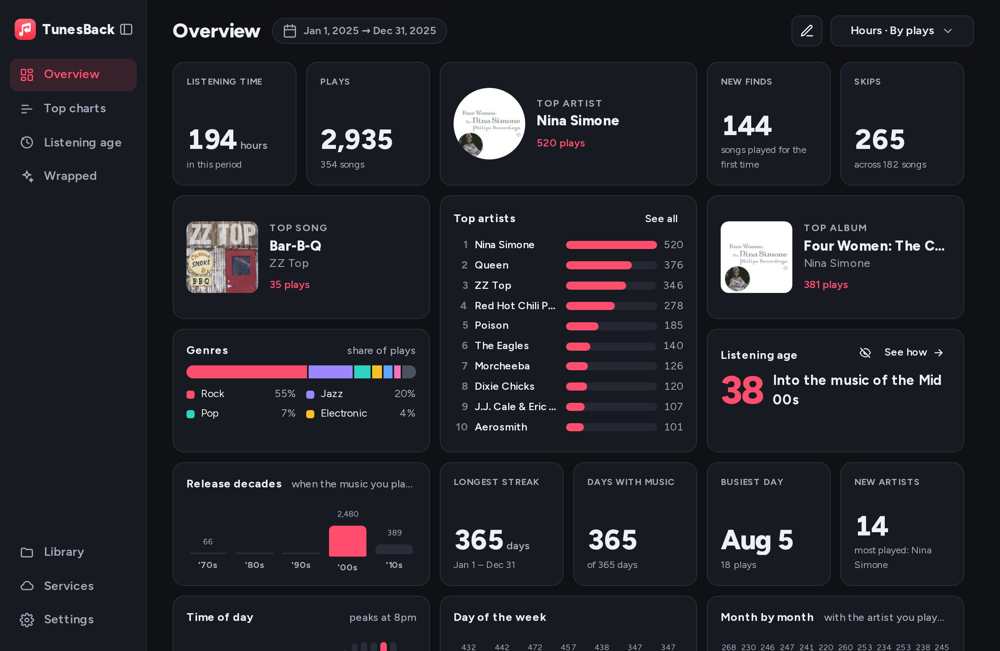
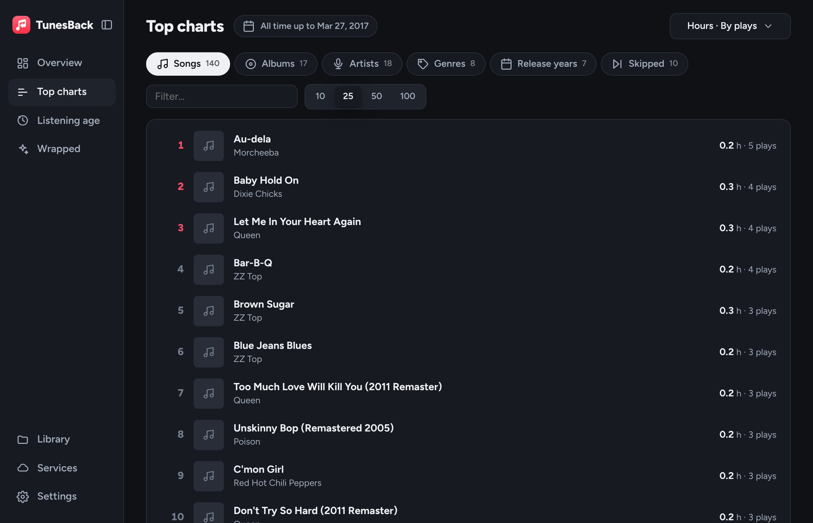
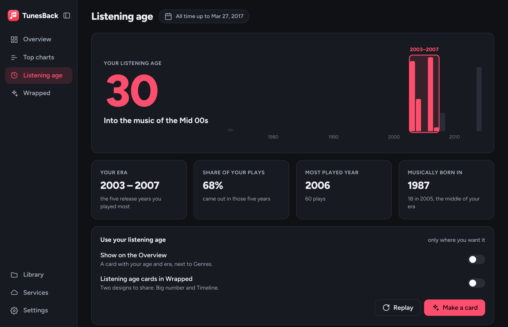
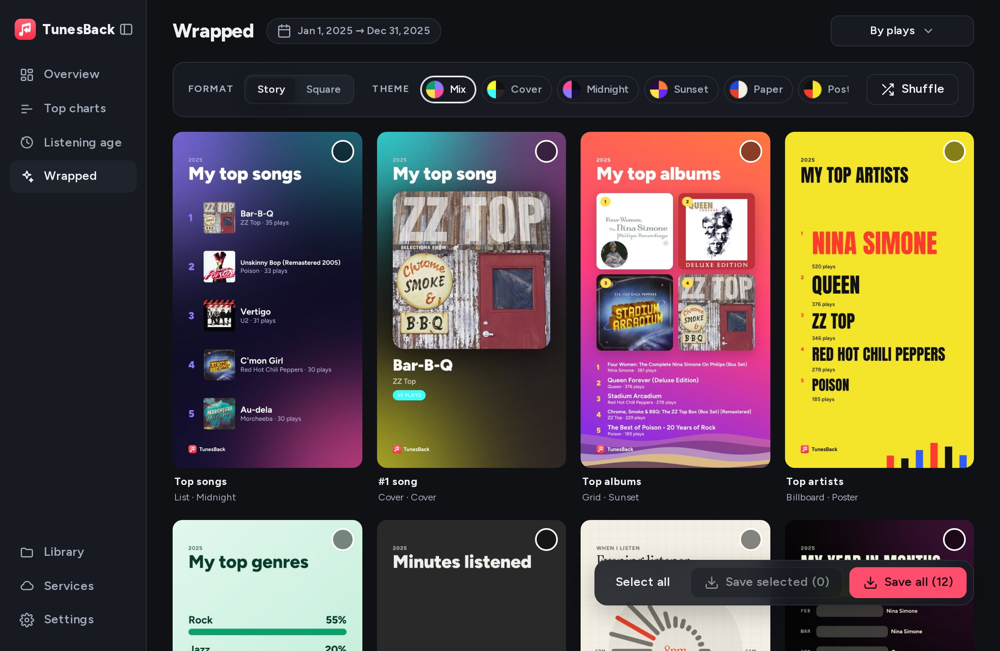

<div align="center">
  

# TunesBack

**Your year in music, from the apps you already use.**

A Wrapped-style recap for iTunes and Apple Music libraries, Last.fm, ListenBrainz and Spotify,
worked out entirely on your computer.

[](https://github.com/mooseses/TunesBack/releases)
[](https://github.com/mooseses/TunesBack/actions/workflows/build.yml)
[](LICENSE)

**[Download](#download)** · [Features](#features) · [Sources](#sources) · [How it works](#how-the-numbers-are-worked-out) · [Privacy](PRIVACY.md)

</div>

<p align="center">
  
</p>

> **TunesBack 2.0 is in beta.** It's a complete rewrite of 1.x, with more sources, an Overview you arrange
> yourself and shareable Wrapped cards. Please [report anything that looks wrong](https://github.com/mooseses/TunesBack/issues/new/choose).

## Why TunesBack?

Spotify has Wrapped and Apple Music has Replay. But if you keep your own music library, listen on an iPod,
or spread your listening over several apps, nobody tells you what your year sounded like.

TunesBack does. Point it at your iTunes or Apple Music library, your Last.fm or ListenBrainz profile, or your
Spotify history download, and it shows your top songs, artists, albums and genres, when you listen, how old
your taste is, and turns it all into cards you can share. Use one source or combine them without counting the
same listen twice.

## Download

Get the latest version from **[Releases](https://github.com/mooseses/TunesBack/releases)**. Betas are marked "Pre-release".

| System | File | |
|---|---|---|
| Windows 10 and 11 | `TunesBack-Windows-…-x64.exe` | Installer. `…-portable.zip` runs without installing |
| Mac with Apple silicon (M1 and later) | `TunesBack-macOS-…-arm64.dmg` | |
| Mac with an Intel processor | `TunesBack-macOS-…-x86_64.dmg` | |
| Debian, Ubuntu, Mint, Pop!_OS | `TunesBack-Linux-…-x86_64.deb` | `sudo apt install ./TunesBack-Linux-…-x86_64.deb` |
| Fedora and other RPM-based systems | `TunesBack-Linux-…-x86_64.rpm` | `sudo dnf install ./TunesBack-Linux-…-x86_64.rpm` |
| Arch, Manjaro, EndeavourOS | `TunesBack-Linux-…-x86_64.pkg.tar.zst` | `sudo pacman -U ./TunesBack-Linux-…-x86_64.pkg.tar.zst` |
| Any Linux, sandboxed | `TunesBack-Linux-…-x86_64.flatpak` | `flatpak install --user ./TunesBack-Linux-…-x86_64.flatpak` |
| Any Linux | `TunesBack-Linux-…-x86_64.AppImage` | Make it executable (`chmod +x`) and run it. Also as a `.tar.gz` |

- **Which Mac?** Apple menu → About This Mac: "Chip: Apple M…" is Apple silicon, "Processor: Intel…" is Intel.
- **macOS, first launch:** the app isn't notarized yet, so macOS asks first. Open **System Settings → Privacy & Security** and choose **Open Anyway**.
- **Linux:** every package brings its own Qt, so it doesn't depend on your system's web view. It needs glibc 2.35 or newer (Ubuntu 22.04, Debian 12, Fedora 36 and later). The Flatpak uses Flathub's `org.freedesktop.Platform` 24.08 runtime.
- **Updates:** TunesBack checks GitHub once a day and offers new versions; you can also use **About TunesBack → Check for Updates**. Betas are offered to beta users, or to anyone who turns on **Settings → Get beta versions**.

## Features

### Your stats, for any period

- **Overview:** listening time, plays, new finds, skips, your top artist, song and album, top lists, genres,
  release decades, when you listen and more, as tiles you arrange like the Windows Phone Start screen.
  **Customize** lets you drag them around, make them Medium, Wide or Large, remove them and add others.
- **Top charts:** songs, albums, artists, genres, release years, new finds and skipped songs, 10 to 100 rows,
  with album art.
- **Any period:** this year, last year, the last 12 months, all time or your own dates.
- **When you listen** (for sources that log every listen): by hour and weekday, month by month with your top
  artist, your longest streak, busiest day and the artists you discovered.
- **Hours, minutes or days, by plays or by time:** the **View** button at the top right switches both.

<p align="center">
  
  
</p>

### Wrapped cards

<p align="center">
  
</p>

- Story (1080 × 1920) or square (1080 × 1080) images of your top songs, #1 song, top albums, top artists,
  genres, minutes listened, a summary and, with listening dates, the listening clock, your year in months,
  your streak and discoveries.
- Each card has two or three **layouts** (a list, a spotlight, a receipt, a vinyl record, a calendar…) and nine
  **themes**, including **Cover**, which takes its colours from your top album's artwork.
- **Shuffle** gives every card its own layout and theme; **Undo** takes it back. Click a card to choose its
  design, hide it, or save just that one.
- Long titles shrink and wrap before they're cut short, and titles in other scripts (Japanese, Korean,
  Cyrillic, Arabic…) use a font installed on your computer.

### Listening Age

How old your taste is: TunesBack finds the five release years you played most and works out how old you'd be
if you were 18 in the middle of them. It has its own page, explained step by step with your own numbers, and
it only appears on the Overview or in Wrapped if you choose. [How it's calculated](#listening-age-1).

### At home on every system

- **macOS:** a native sidebar (Liquid Glass on macOS Tahoe), the macOS menu bar, and controls to match.
- **Windows 11:** Mica behind the window, TunesBack's own title bar (or the system's), slim auto-hiding scrollbars.
- **Linux:** the global menu on KDE Plasma, or a menu bar in the title bar that Alt shows and hides.
- Light and dark, or following the system. Keyboard shortcuts for every view.

### Private

TunesBack collects no data: no account, no analytics, no tracking. Your library and listening history stay on
your computer. It only goes online to read the accounts you connect, fetch album covers for them, and check for
updates. See the [Privacy Policy](PRIVACY.md).

## Sources

The first time you open TunesBack, it asks which music apps you use and sets each one up. Add more later from
**Library → Add source** or **File → Add Source…**.

**iTunes / Apple Music.** iTunes keeps a running play count per song, not a history, so TunesBack takes a
*reading* of your library each time it opens and compares readings to see what you played in between. It
finds the library on this computer or a network drive; otherwise point it to the file (in iTunes or Music:
**File → Library → Export Library**). Older exports can be added as extra readings to go further back. On
Windows, *Edit → Preferences → Advanced → Share iTunes Library XML with other applications* keeps the file
up to date.

**Last.fm.** Your user name and a free [API key](https://www.last.fm/api/account/create) (any app name works;
release builds may include one). The first import fetches your whole history (200 scrobbles a request, a few requests a
second); you can stop at any time and it carries on later. After that, each launch fetches only what's new. Your
profile's recent listening must be public.

**ListenBrainz.** Just your user name.

**Spotify.** In [Spotify's privacy settings](https://www.spotify.com/account/privacy/), request your **Extended
streaming history** (it can take a few days), then choose the `.zip` Spotify sends you. The quicker "Account
data" download works too, with your last year. A listen counts from 30 seconds on, like on Spotify; podcasts
and audiobooks are left out. Add a newer download to update.

The **Services** page shows each account's sync status, how much history is imported and its recent syncs.

## How the numbers are worked out

### Combining sources

On the **Library** page, the recap uses one source or all of them. With several, you say whether they record
the **same** listening (iTunes scrobbling to Last.fm: each song counts once, from the source with more plays)
or **separate** listening (your phone and your computer: plays add up).

Songs are matched across sources by title and main artist, ignoring case and accents. Only explicit "feat.",
"ft.", "featuring", `;` and ` / ` credits are split, so duos like "Simon & Garfunkel" stay together. Versions
such as "(Remastered)" or "- Live" count as different songs.

Sources that log listens borrow genre, release year, length and artwork from your iTunes library when a song
is in it, so genres and Listening Age work for them too. Last.fm doesn't record song lengths, so for songs
that aren't in your library, listening time uses an average length and is marked as estimated.

### New finds

- **Last.fm, ListenBrainz and Spotify:** a song whose first play ever falls in the period. **Discoveries** do
  the same for artists, once there's at least a month of history before the period.
- **iTunes:** a song added to your library during the period and played. TunesBack matches songs between readings by
  iTunes' **Persistent ID**, which survives renaming, moving and re-tagging; if IDs changed (a rebuilt
  library), it falls back to title, artist and album when that's unambiguous, and checks the date added.

### Listening Age

1. Add up the period's plays by each song's release year.
2. Slide a five-year window over those years and find the window with the most plays: your era.
3. Assume you were 18 in the middle of it: **Listening Age = this year − (middle of your era − 18)**.

For example, an era of 2010–2014 has its middle in 2012, so you'd have been born in 1994 and your Listening
Age in 2025 is 31. A Listening Age below your real age means you lean towards newer music; above it, older.
The code is in `tunesback/stats/listening_age.py`.

## Troubleshooting

**Album art is missing.** TunesBack reads artwork embedded in your music files (or a `cover.jpg`,
`folder.jpg` or `front.jpg` next to them). Artwork iTunes downloaded with "Get Album Art" is stored elsewhere
and can't be read. Files on network shares need the share to be mounted first. TunesBack converts paths
between systems: UNC paths on Windows, GVFS and KIO mounts on Linux, `/Volumes` on macOS.

**Something else looks wrong.** Turn on the **Dev space** in Settings, then **Dev space → Detailed logging**,
reproduce the problem and attach the end of the log to an [issue](https://github.com/mooseses/TunesBack/issues/new/choose).
Logs are in:

- macOS: `~/Library/Logs/TunesBack/`
- Windows: `%LOCALAPPDATA%\TunesBack\Logs\`
- Linux: `~/.cache/TunesBack/logs/`

**Starting over.** **Dev space → Start over** resets every setting and returns to set-up, optionally
forgetting your library too.

## Building from source

Requires Python 3.10 or newer.

```bash
git clone https://github.com/mooseses/TunesBack.git
cd TunesBack
python3 -m venv venv && source venv/bin/activate   # Windows: venv\Scripts\activate
pip install .            # on Linux: pip install ".[qt]" for the Qt web view
tunesback
```

TunesBack opens in a native window using the system's web view (WebView2 on Windows, WebKit on macOS, Qt
WebEngine or WebKitGTK on Linux), or in your browser if there isn't one (`tunesback --browser`). On KDE
Plasma, use your distribution's PyQt6 WebEngine packages (in a venv made with `--system-site-packages`) for the
global menu on Wayland.

### Development

```bash
pip install -e ".[dev]"
pytest                                  # the tests
tunesback --browser --debug             # in a browser tab, with detailed logging
pyinstaller packaging/tunesback.spec    # the app, in dist/
```

```
tunesback/
  sources/     iTunes libraries; Last.fm, ListenBrainz and Spotify listens
  library.py   TunesBack's store: library readings and every listen (SQLite)
  recap.py     a report from any mix of sources over a period
  stats/       period activity, rankings, Listening Age, when you listen
  cards/       Wrapped cards: SVG canvas, text fitting, fonts, themes, layouts
  art/         finding music files and their artwork
  app/         the local API server, settings, window, menus, macOS integration
  web/         the interface (plain HTML, CSS and JavaScript; no build step)
  updates.py   checking GitHub for new versions
packaging/     PyInstaller spec, icons, Linux packages and Flatpak, release notes, smoke tests
```

The interface talks to a small JSON API on `127.0.0.1` that needs a per-launch token, so other websites can't
reach it. Release builds can include a Last.fm API key from the `LASTFM_API_KEY` repository secret; from
source, set `TUNESBACK_LASTFM_API_KEY`.

### Releasing

Bump the version in `pyproject.toml` and `tunesback/__init__.py`, add its section to `CHANGELOG.md`, then
run the **Build** workflow on `main` with **Publish a release** ticked (or push a tag like `v2.0.0-beta.2`).
It builds every download, tests the Linux packages on Fedora and Arch, and publishes the release with notes
from the changelog and checksums. Pre-release versions are published as pre-releases.

## Credits

- [pywebview](https://pywebview.flowrl.com/) for the native window, [resvg](https://github.com/linebender/resvg)
  (via [resvg-py](https://github.com/baseplate-admin/resvg-py)) to draw cards, [Pillow](https://pillow.readthedocs.io/),
  [mutagen](https://mutagen.readthedocs.io/) and [python-dateutil](https://dateutil.readthedocs.io/).
- Typefaces under the SIL Open Font License: [Figtree](https://github.com/erikdkennedy/figtree),
  [Instrument Serif](https://github.com/Instrument/instrument-serif), [Space Mono](https://github.com/googlefonts/spacemono)
  and [Anton](https://github.com/googlefonts/AntonFont).
- Service logos from [Simple Icons](https://simpleicons.org/) (CC0); the ListenBrainz logo is by the
  [MetaBrainz Foundation](https://github.com/metabrainz/design-system) (CC BY-SA 4.0). The marks belong to their
  owners and only name the services.

## License

[GPL-3.0](LICENSE).
