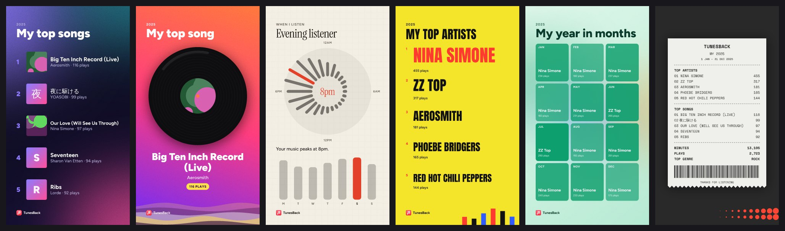
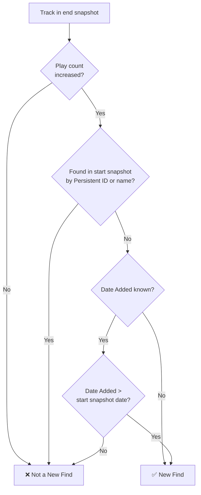

<div align="center">
  
  
# **TunesBack**

**The replay statistics for the rest of us.**

*Year-in-review for your music library: iTunes, Last.fm, ListenBrainz and Spotify.*

  [](https://www.gnu.org/licenses/gpl-3.0)
  


 📖 [Quick Start](https://github.com/mooseses/TunesBack#quick-start)

  <br/>

</div>

<div align="center">
  
  
</div>
<div align="center">
  <em>TunesBack App - Library and Overview</em>
</div>

## Why TunesBack?

Spotify has Wrapped. Apple Music has Replay. But what about iTunes and iPod users, or anyone whose listening is spread over several apps?

TunesBack brings year-end analytics to the music you already have. Track your listening habits, see your top artists, albums and songs, see *when* you listen, and discover how your taste evolves over time.

Works on **Windows, macOS, and Linux** with:

- **iTunes / Apple Music** libraries (TunesBack keeps its own readings of the library over time)
- **Last.fm** and **ListenBrainz** profiles (every scrobble, with the time you played it)
- **Spotify** listening history downloads

## Features

- **Several sources at once**: iTunes, Last.fm, ListenBrainz and Spotify, on their own or combined, without counting the same listen twice
- **Any period**: this year, last year, the last 12 months, all time or your own dates; for iTunes, compare two readings
- **When you listen** (sources with timestamps): listening by hour and weekday, month by month with your top artist, longest streak, busiest day and the artists you discovered
- **Overview dashboard**: listening time, plays, new finds, skips, top artist/album/song, top artists chart, genre share, release decades and Listening Age
- **Top charts** for Songs, Albums, Artists, Genres, Release Years, New Finds and Skipped tracks, with filtering and 10–100 rows
- **Album art** displayed alongside track details, loaded as you scroll
- **Network share support**: seamlessly works with UNC paths (Windows) and GVFS/CIFS mounts (Linux)
- **Wrapped cards:** shareable story or square images, with several layouts and themes per card, and a Shuffle button
- **Listening Age:** calculates the "era" of music you gravitate toward, with its own page: press Calculate and watch a five-year window sweep across your release years to your era
- **Services page:** your Last.fm and ListenBrainz accounts and Spotify downloads at a glance: sync status, how much history is imported, recent syncs, Sync now / Stop, and the Last.fm API key
- **Resizable sidebar:** drag its edge to resize it, drag it narrow (or press Ctrl/⌘+B) to hide it
- **Dev space** (turn it on in Settings): sync dry runs that fetch but store nothing, feature flags (offline, slow network, card guides, reduced motion…), a card lab, request log and diagnostics
- **Flexible display:** switch between hours, minutes and days; rank by plays or listening time
- **Dark and light mode**, or follow the system
- **Native-feeling window:** TunesBack's own title bar by default (or your system's, in Settings), a File/View/Help menu bar with keyboard shortcuts, the macOS menu bar on Macs and the global menu on KDE Plasma
- **Private:** your listening history is kept and analysed on your machine. TunesBack only goes online to read your Last.fm or ListenBrainz profile and album covers for them

## Wrapped Cards

Shareable images of your listening, made in the Wrapped view.

<p align="center">
  
</p>

**Cards:** Top songs, #1 song, Top albums, Top artists, Top genres, Minutes listened, Listening age and a Summary. Sources with timestamps add the Listening clock, Year in months, Streak and Discoveries.

**Designs:** each card has two or three **layouts** (a list, a spotlight, a receipt, a vinyl record, a calendar…) and comes in nine **themes**: Midnight, Sunset, Paper, Poster, Mint, Mono, Neon, Classic (the TunesBack 1.x look), and **Cover**, which takes its colours from your top album's artwork.

- Pick a theme for the whole deck, or **Mix** for a different one on every card.
- **Shuffle** gives every card a new layout (and theme, with Mix). The same shuffle always gives the same deck, and **Undo** takes it back.
- Click a card to choose its layout and theme, hide it from the deck, or save just that one.
- **Story** (1080×1920) or **Square** (1080×1080).
- Your design is remembered, so next year's cards look the same until you change them.

Rankings follow the "By plays / By time" switch at the top right. Long titles shrink, wrap and only then get cut short, and titles in other scripts (Japanese, Korean, Cyrillic, Arabic…) are drawn with a font installed on your computer.

## Listening Age

TunesBack computes a single-number summary called the "Listening Age" to describe the era that most strongly characterizes your listening habits. The metric is inspired by the psychological "reminiscence bump", which is the tendency for music encountered during one's formative years to retain stronger emotional significance.

The following chart explains its methodology:

<div align="center">
  
<br/>
  <em>Listening Age Algorithm</em>
</div>


#### How the metric is calculated (algorithmic summary):

- Aggregate play counts by each track's release year.
- Slide a 5-year window across the years in your data and compute the total plays for each window.
- Select the 5-year window with the highest total plays (the "peak era").
- Take the center year of that window and assume the listener was 18 at that midpoint.
- Calculate Listening Age as: current year − (midpoint year − 18).

Formula:

```
Listening Age = Current Year - (Peak Era Midpoint - 18)
```

Example:

- Peak window: 2010–2014 → midpoint 2012
- Assumed birth year: 2012 − 18 = 1994
- Listening Age (in 2025): 2025 − 1994 = 31

Notes and interpretation:

- A Listening Age lower than your chronological age indicates a preference for more recent releases.
- A Listening Age higher than your chronological age indicates a preference for older material.
- The method uses a fixed 5-year window and a formative age constant of 18; these parameters reflect a balance between sensitivity and robustness in typical music libraries.

Implementation details: the algorithm (see `tunesback/stats/listening_age.py`) filters out invalid years, sums the period's plays per release year, evaluates every 5-year window, selects the highest-sum window, and computes the final age as shown above. "Current year" is the year of the (end) snapshot, so older snapshots get the age you had back then.

## New Music Finding

When comparing two library snapshots, a track counts as a **New Find** when it was added to your library during the period and played. Tracks that were already in your library but simply hadn't been played don't count.

### Classification Criteria

A track in the end snapshot is a **New Find** only if **all** of the following are true:

1. **Played in the period**: its play count went up between the two snapshots.
2. **Not in the start snapshot**: no track with the same **Persistent ID** exists there. If IDs changed (for example after rebuilding the library), TunesBack also matches on title, artist and album, as long as that match is unambiguous.
3. **Added after the start snapshot**: if the track has a `Date Added`, it must be later than the start snapshot's date. This catches existing tracks that couldn't be matched.

New Finds are only shown when comparing two snapshots.

For **Last.fm, ListenBrainz and Spotify**, a New Find is a song whose first play ever (in that source's whole history) falls in the period. The **Discoveries** stats and card do the same for artists, as long as the history goes back at least a month before the period, so a brand-new account doesn't make everything look new.

### Why Persistent ID?

iTunes assigns each track a unique **Persistent ID** that remains constant even if the file is renamed, moved, or re-tagged. Matching by ID first means edited metadata doesn't turn an old favourite into a "new" track.

### Decision Flow



Implementation details: see `period_activity()` in `tunesback/stats/period.py`.

## Sources

### iTunes / Apple Music

iTunes only keeps a running play count per song, so TunesBack reads your library **each time it opens** and keeps those readings. Comparing two readings gives the plays in between. Older exports can be imported as extra readings (Library page, or File → Import Older iTunes Exports…).

When a recap uses dates (or mixes iTunes with other sources), TunesBack uses the readings closest to the start and end of the period, and the recap shows which dates they actually cover.

### Last.fm

Set-up asks for your user name. Reading scrobbles needs a free **API key**: [create one](https://www.last.fm/api/account/create) (any app name works) and paste the "API key" it shows. TunesBack remembers it; change it on the Services page. Release builds can come with a key, in which case set-up doesn't ask.

The first import fetches your whole history (200 scrobbles per request, a few per second, so a long history takes a few minutes). You can stop at any time: TunesBack keeps what it has and carries on the next time it opens. After that, each launch fetches only what's new. Your profile's recent listening must be public.

Last.fm doesn't record song lengths, so listening time uses the length from your iTunes library when the song is in it, and an average song length otherwise. Those times are marked as estimated.

### ListenBrainz

Just your user name; no key needed. Works like Last.fm, and uses the song lengths ListenBrainz has.

### Spotify

In [Spotify's privacy settings](https://www.spotify.com/account/privacy/), request your **Extended streaming history** (it can take a few days), then choose the `.zip` Spotify sends you. The quicker "Account data" download works too, with your last year of listening. Like Spotify, a listen counts as a play from 30 seconds on; podcasts and audiobooks are left out. To update, add a newer download: listens already imported are skipped.

### Combining sources

On the Library page, the **Recap** card picks one source or **All sources**. With more than one, it asks whether they record the **same** listening (for example iTunes scrobbling to Last.fm: each song counts once, using the higher number) or **separate** listening (your phone and your computer: plays add up). Songs are matched by title and main artist.

Sources that log listens also borrow genre, release year and artwork from your iTunes library when the song is in it, so genres and the Listening Age work for them too.

## Album Art & Network Share Support

TunesBack extracts album artwork directly from your audio files using **embedded metadata tags** and features **intelligent path resolution for network shares**. This ensures artwork displays even when files are stored on remote servers or have been moved.

### How it works

1. **Direct extraction**: Uses [Mutagen](https://mutagen.readthedocs.io/) to read embedded artwork from audio file tags (ID3, MP4, FLAC, etc.). If a file has none, a `cover.jpg`, `folder.jpg` or `front.jpg` next to it is used instead
2. **Smart path resolution for network shares**: Automatically handles:
   - **Windows UNC paths**: Converts `file://server/share/...` to `\\server\share\...`
   - **Linux GNOME/GVFS**: Auto-detects mounts at `/run/user/<uid>/gvfs/smb-share:...`
   - **Linux KDE/kio-fuse**: Auto-detects Dolphin mounts at `/run/user/<uid>/kio-fuse-*/smb/...`
   - **macOS network volumes**: Resolves `/Volumes/...` paths
   - **Moved files**: Works as long as the new path is accessible
3. **No configuration needed**: Network paths are resolved automatically across all platforms


### Troubleshooting missing artwork

If album art doesn't appear:

1. Turn on **Settings → Detailed logging**
2. Check the log file for path resolution errors:
   - **macOS:** `~/Library/Logs/TunesBack/tunesback.log`
   - **Windows:** `%LOCALAPPDATA%\TunesBack\Logs\tunesback.log`
   - **Linux:** `~/.cache/TunesBack/logs/tunesback.log`
3. Verify your audio files have embedded artwork:
   ```bash
   # macOS/Linux
   ffprobe -v error -show_entries format_tags=title -of default=noprint_wrappers=1 "song.mp3"
   
   # Or use any audio tagger to check
   ```
4. For network shares, ensure they're mounted before starting TunesBack

### Network share setup

**Windows:**
- Map network drive or use UNC paths directly
- XML paths like `file://server/share/Music/...` and `file://localhost//server/share/...` are automatically converted

**Linux:**
- **KDE/Dolphin**: Simply browse to the network share in Dolphin before launching TunesBack
- **GNOME/Nautilus**: Connect via Files → Other Locations → Connect to Server
- **Manual mount**:
  ```bash
  sudo mount -t cifs //server/share /mnt/music -o username=user
  ```


## Quick Start

### 1. Run TunesBack

**Download from** [Releases](https://github.com/mooseses/TunesBack/releases)

| Platform | Format |
|----------|--------|
| Windows | Installer (`.exe`) |
| macOS | Disk image (`.dmg`) |
| Linux | AppImage, or a `.tar.gz` of the same app |

> **macOS:** You may need to go to **System Settings → Privacy & Security** and click "Open Anyway" the first time.

> **Linux:** the packaged app brings its own Qt, so it doesn't depend on your system's web view. Make the AppImage executable (`chmod +x`) and run it.

### Run from source (any platform)

Requires Python 3.10+.

```bash
git clone https://github.com/mooseses/TunesBack.git
cd TunesBack
python3 -m venv venv
source venv/bin/activate        # Windows: venv\Scripts\activate
pip install .
tunesback
```

TunesBack opens in its own window using your system's web view (WebView2 on Windows, WebKit on macOS). On Linux it needs GTK WebKit or Qt:

```bash
# Debian/Ubuntu: GTK WebKit (create the venv with --system-site-packages so it can see these)
sudo apt install python3-gi gir1.2-webkit2-4.1
# or, inside any venv: Qt WebEngine
pip install ".[qt]"
```

If no web view is available, TunesBack opens in your default browser instead. You can also ask for that with `tunesback --browser`.

**KDE Plasma:** TunesBack uses Qt on Plasma so its menu can appear in the global menu bar. Install your distribution's Qt WebEngine bindings (Debian/Ubuntu: `sudo apt install python3-pyqt6 python3-pyqt6.qtwebengine python3-qtpy`, in a venv created with `--system-site-packages`). On Wayland the global menu needs the distribution's Qt (with Plasma's platform theme), not the pip `PyQt6` wheels; on X11 either works. Without Qt, TunesBack uses GTK and shows the menu in its own title bar.

### 2. Set up

The first time you open TunesBack, a short set-up asks which music apps you use, then sets up each one:

- **iTunes / Apple Music:** on this computer or a network drive? TunesBack finds the library, takes a first reading, and remembers where it is. If it can't find it, point it to the file or to a folder of exports (in iTunes or Music: **File → Library → Export Library**). On Windows you can also turn on *Edit → Preferences → Advanced → Share iTunes Library XML with other applications* so iTunes keeps the file up to date.
- **Last.fm / ListenBrainz:** your user name (and, for Last.fm, an API key). The history is imported right away.
- **Spotify:** choose your downloaded listening history.

Add more sources later from the Library page or File → Add Source….

### 3. Explore

Every time it opens, TunesBack reads your iTunes library again and fetches new listens from Last.fm and ListenBrainz (File → Check for New Listens does it on demand).

- **Library**: your sources, and the period (and sources) to recap
- **Overview** and **Top charts**: your stats for that period
- **Listening age**: your era, with an animated reveal
- **Wrapped**: shareable cards
- **Services**: your online accounts and downloads, and how their syncing is going

## Snapshot Dates

Every library export records when it was made, and TunesBack reads that date from inside the file, so file names don't matter.

For XML files without that header, TunesBack falls back to a date in the file name (e.g. `2025-12-01.xml`), and then to the file's modification date. The Library screen labels snapshots whose date came from a fallback.

### Automating exports

You can schedule a task to copy your library XML to a snapshots folder:

**macOS/Linux (cron):**

```bash
# Monthly on the 1st at midnight
0 0 1 * * cp ~/Music/iTunes/iTunes\ Library.xml ~/Music/Snapshots/$(date +\%Y-\%m-\%d).xml
```

**Windows (PowerShell via Task Scheduler):**

```powershell
$date = Get-Date -Format "yyyy-MM-dd"
Copy-Item "$env:USERPROFILE\Music\iTunes\iTunes Library.xml" "$env:USERPROFILE\Music\Snapshots\$date.xml"
```

## Known Limitations

- **Album art** is extracted from embedded tags. iTunes' "Get Album Art" feature stores artwork separately and won't be picked up.
- **Moved libraries**: if your music files have moved and the XML paths are outdated, artwork won't load. Enable debug logging to investigate.
- **Network shares**: path resolution works best when shares are already mounted.
- **Music app on a Mac**: it doesn't write a library file by itself, so export the library (File → Library → Export Library) and add the export.
- **Last.fm listening time** is estimated for songs that aren't in your iTunes library (Last.fm doesn't record song lengths).
- **Card fonts**: titles in scripts the bundled fonts don't cover use a font installed on your computer, in its regular weight.
- **Artist credits**: only explicit "feat." / "ft." / "featuring", `;` and ` / ` credits are split into separate artists, so duos like "Simon & Garfunkel" stay together.

Turn on **Settings → Detailed logging** to see why artwork might be missing.

## Tech Stack

- [pywebview](https://pywebview.flowrl.com/): native window around the HTML/CSS/JS interface
- [resvg](https://github.com/linebender/resvg) (via [resvg-py](https://github.com/baseplate-admin/resvg-py)): draws the Wrapped cards from SVG
- [Pillow](https://pillow.readthedocs.io/): artwork, card backgrounds and image output
- [mutagen](https://mutagen.readthedocs.io/): audio metadata extraction
- [python-dateutil](https://dateutil.readthedocs.io/): date parsing
- Typefaces, all under the SIL Open Font License: [Figtree](https://github.com/erikdkennedy/figtree), [Instrument Serif](https://github.com/Instrument/instrument-serif), [Space Mono](https://github.com/googlefonts/spacemono) and [Anton](https://github.com/googlefonts/AntonFont)

## Development

```bash
pip install -e ".[dev]"
pytest                      # run the tests
tunesback --browser --debug # run in a browser tab with verbose logging
pyinstaller packaging/tunesback.spec   # build the app into dist/
```

Project layout:

```
tunesback/
  sources/                iTunes libraries; Last.fm, ListenBrainz and Spotify listens
  library.py              TunesBack's store: readings of libraries and every listen (SQLite)
  recap.py                a report from any mix of sources over a period
  model.py                Track and Snapshot, shared by every source
  stats/                  period activity, rankings, Listening Age, timeline statistics
  art/                    file location resolution and artwork
  cards/                  Wrapped cards: SVG canvas, text fitting, fonts, themes, layouts/, deck
  app/                    local API server, settings, window and menu bar
  web/                    the interface (no build step)
tests/
packaging/                PyInstaller spec, icons, Linux AppImage files and smoke tests
```

Release builds can include a Last.fm API key: set the `LASTFM_API_KEY` repository secret (CI writes it into `tunesback/_build.py`), or set `TUNESBACK_LASTFM_API_KEY` when running from source.

The Python side serves the interface and a small JSON API on `127.0.0.1`. Requests need a per-launch token, so other websites can't talk to it.

## Feedback

Found a bug or have a suggestion? [Open an issue](https://github.com/mooseses/TunesBack/issues/new).

## License

GPL-3.0. See `LICENSE` for details.
